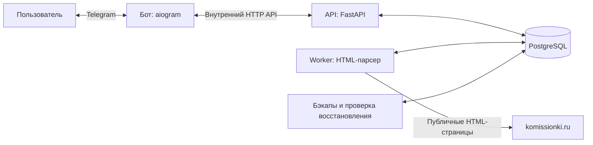

# KomissionkaParseBot

Telegram-бот подписок на новые товары komissionki.ru: категории магазина, поисковые фразы,
фильтры цены, стоп-слов, состояния и городов. Python 3.13, FastAPI, aiogram, PostgreSQL 17,
общий worker HTML-парсинга и Docker Compose. Бот работает в личных чатах.

Пользователь выбирает категории или поисковые фразы, например `macbook`, а бот присылает
новые подходящие товары отдельными сообщениями с фотографиями, ценой, состоянием,
описанием и ссылкой. По умолчанию отслеживаются все города; ограничения задаются в подписке.

## Архитектура



API сохраняет подписки и задания, а единственный worker выполняет запросы к магазину.
Пользователи с одинаковой подпиской используют общий источник данных. Обнаруженные
новинки попадают в постоянную очередь PostgreSQL; бот отправляет их и подтверждает результат.
Это позволяет перезапускать процессы с сохранением подписок, курсоров и состояния доставок.

| Каталог / файл | Содержимое |
|---|---|
| `app/bot*.py` | Telegram-меню, фильтры, админ-команды и рассылка |
| `app/api.py`, `app/routes.py` | Внутренний API |
| `app/worker.py`, `app/crawler.py`, `app/parser.py` | Планирование, лимиты и HTML-парсинг |
| `app/service.py`, `app/models.py` | Подписки, товары, очередь и работа с БД |
| `migrations/` | Миграции Alembic |
| `scripts/` | Создание конфигурации и резервное копирование |
| `tests/` | Тесты и сохранённые HTML-страницы магазина |
| `compose.yaml` | Запуск всех сервисов |

## Запуск

Нужны Docker с Compose v2 и Telegram-токен от [BotFather](https://t.me/BotFather).

```bash
git clone https://github.com/ArthurAipov/KomissionkaParseBot.git
cd KomissionkaParseBot
python3 scripts/configure.py
# Заполните BOT_TOKEN и ADMIN_TELEGRAM_IDS в .env.
docker compose build api
docker compose up -d --no-build
```

`configure.py` создаёт приватный `.env` со случайными паролем БД и ключом API,
не перезаписывая существующий файл. Заполните `BOT_TOKEN` перед запуском.
Секреты, дампы и пользовательские данные не должны попадать в Git или Docker-образ.
`ADMIN_TELEGRAM_IDS` — числовые ID,
разделённые запятыми. Свой ID можно получить командой `/id`. Админство не назначается
по изменяемому username или порядку регистрации; список задаётся владельцем сервиса.

Миграции применяются перед стартом API. API доступен только локально:
[Swagger](http://localhost:8000/docs), [health](http://localhost:8000/health).
В Swagger нажмите Authorize и укажите `API_KEY` из `.env`. Это сервисный ключ с доступом
ко всем данным: он предназначен для бота и внутренних инструментов.
База не публикует порт. Long polling Telegram не требует входящего порта.

Все процессы приложения используют один Docker-образ. В Compose работают `db`, `migrate`,
`api`, `worker`, `bot` и `backups`. `migrate: Exited (0)` означает успешное применение схемы.
Сервисы автоматически перезапускаются Docker при сбое. Для работы на компьютере Docker
должен оставаться запущенным, компьютер — включённым и подключённым к сети.

## Развёртывание на сервере

Для начальной нагрузки 5–10 пользователей ориентир: 2 vCPU, 2 ГБ RAM, SSD от 30 ГБ.
4 ГБ RAM дают дополнительный запас для сборки и резервного копирования. Это оценка
по текущему потреблению, а не гарантия производительности для любого числа подписок.
Нужны Linux, Git, Python 3 для настройки и Docker Engine с Compose.

```bash
git clone https://github.com/ArthurAipov/KomissionkaParseBot.git /opt/komissionki-watcher
cd /opt/komissionki-watcher
python3 scripts/configure.py
# Заполнить BOT_TOKEN и ADMIN_TELEGRAM_IDS в .env приватным редактором.
docker compose build api
docker compose up -d --no-build
docker compose ps
curl --fail http://127.0.0.1:8000/health
```

Если на сервере уже есть другие проекты, заранее проверьте, что имя Compose-проекта
`komissionki-watcher` и локальный порт `8000` свободны. Приложение использует собственные
сеть и volumes; команды выполняются только из его каталога. Порты 80/443 не требуются:
бот использует long polling, API слушает только `127.0.0.1:8000`, порт БД наружу не открыт.
Доступ к Swagger с компьютера можно получить через SSH-туннель:

```bash
ssh -L 18000:127.0.0.1:8000 user@server
# В браузере: http://127.0.0.1:18000/docs
```

При переносе существующей установки сначала остановите её `bot`, `worker`, `backups`
и `api`, получите свежий `pg_dump -Fc`, затем передайте `.env` и дамп отдельно по SSH.
На новом сервере запустите только `db`, восстановите дамп в пустую БД и лишь затем
запустите остальные сервисы. Сохраняются пользователи, подписки, фильтры, товары,
курсоры, Telegram file IDs и история доставок; локальный кеш JPEG можно создать заново.
Один Telegram-токен должен обслуживать только один активный экземпляр бота.

Обновление кода:

```bash
cd /opt/komissionki-watcher
git pull --ff-only
docker compose build api
docker compose up -d --no-build
```

Перед обновлениями сохраняйте проверенный бэкап. Автозапуск контейнеров обеспечивается
политикой `restart: unless-stopped`; сам Docker должен запускаться вместе с сервером.
Не используйте глобальные очистки Docker или перезапуск всего Docker для обновления
этого приложения на общем сервере.

## Команды пользователя

- `/start` — регистрация и выбор подписок.
- `/categories` — дерево каталога, подписки на разделы и подкатегории.
- `/search macbook` — поиск по всему магазину.
- `/subscriptions` — подписки, кнопки настройки фильтров и удаления.
- `/status` — последняя и следующая проверка, число проверенных и подходящих новых товаров,
  причина отсутствия сообщений, состояние очереди.
- `/now` или «Получить сейчас» — до 15 текущих товаров суммарно по своим подпискам для просмотра.
- `/pause`, `/resume` — приостановка и продолжение обычных уведомлений.
- `/cancel` — отмена ввода; `/menu` — меню; `/id` — свой Telegram ID.

Обычные уведомления содержат только новинки. Отсутствие сообщений при успешных проверках
может означать «новинок нет». В статусе также видны «подписка инициализируется»,
«сайт недоступен», «идёт проверка страниц» и «уведомления на паузе».
Пауза сохраняет настройки, товары за время паузы не накапливаются для последующей рассылки.

### Фильтры

В «Мои подписки» нажмите ⚙️ напротив нужной подписки:

- Цена: две границы, например `0 60000`; `- 60000` — без нижней, `- -` — без ограничений.
- Стоп-слова: через запятую, например `запчасти, неисправен`; `-` — убрать.
- Состояние: несколько вариантов кнопками, пустой выбор означает любое.
- Города: несколько городов из списка магазина, пустой выбор означает все города.

Разные группы фильтров должны выполниться одновременно; варианты внутри состояния/городов
соединяются по «или». Стоп-слова проверяются без учёта регистра в названии и описании.
Фильтры индивидуальны для каждой подписки. Они не вызывают дополнительные запросы к магазину.
Изменение фильтров не рассылает старые товары; для текущих предложений используйте `/now`.
Перед получением из очереди условия проверяются снова, чтобы удалённая подписка или
новое ограничение цены не привели к отправке уже неподходящей позиции.
Лимит первой версии — 20 подписок на пользователя.

## Обход до известного товара

Ограничения 15 для автоматической проверки больше нет. Для категорий worker начинает
с первой страницы «Новинки», сохраняет новые позиции и идёт по реальному курсору `sa`,
пока не встретит товар, известный этому источнику **до начала текущего прохода**.
После этого проверка завершена; следующие страницы не запрашиваются.
Товар, сохранённый в другой категории или другой поисковой подписке, не служит границей.
Товары, добавленные во время незавершённого прохода, также не служат преждевременной
границей после перезапуска. Курсор и прогресс сохраняются в PostgreSQL.

Первый проход нового источника сохраняет всю первую HTML-страницу без рассылки и завершает
инициализацию. Для каждого нового подписчика ближайший завершённый проход источника
служит собственной базовой выборкой. У магазина в HTML обычно 20 позиций на страницу;
в дальнейшем число найденных новинок может быть и 45, и больше, без лимита рассылки 15.

**Поиск магазина имеет важное отличие:** несмотря на параметр сортировки, в сохранённом
HTML поисковые результаты могут приоритизироваться по релевантности. Известный товар
может оказаться перед более новой позицией. Для таких источников ранняя остановка
отключена: выполняется проход по страницам до конца, с сохранением курсора и ограничением
нагрузки. Неупорядоченная страница категории также отключает раннюю остановку в этом проходе.
Остановка на первом известном товаре надёжна при стабильной сортировке магазина;
приоритет товаров с фотографиями, изменение ранжирования или задним числом выставленные
даты могут влиять на полноту обнаружения.

Дополнительно учитывается `createdAt`: товар, созданный по данным магазина раньше подписки,
не отправляется как новинка. Повторно увиденный товар, изменение цены и возврат старой
позиции не создают повторное уведомление. Уникальная пара `(user_id, product_id)` в БД
устраняет повторы между поиском и категориями.

Статус считает просмотренные позиции до остановки и подходящие новые позиции по каждой
подписке. Незавершённый проход показан как выполняющийся. Ошибка HTML/повтор страницы
не превращаются в пустую успешную проверку. Порция обхода — `CRAWL_PAGES_PER_TURN=3`,
после чего источник уступает очередь другим подпискам.

## Интервалы и временные режимы

По умолчанию `SCAN_INTERVAL_SECONDS=1800` (30 минут). На работающем экземпляре можно
временно изменить интервал для всех через `/interval 5 30`: каждые 5 минут на 30 минут,
затем автоматически вернётся обычный интервал. `/interval off` отменяет переопределение.
Таймер хранится в БД и сохраняется при перезапуске. Статус показывает действующий интервал.
Завершение текущей отправки/HTTP-запроса может произойти после истечения таймера.

`/test 15` — отдельная тестовая рассылка **только вызвавшему её админу**: текущая подборка
с повторами каждые 5 минут в течение 15 минут. Это позволяет проверить доставку при
отсутствии новинок. `/test off` выключает её; доступны длительности от 5 до 60 минут.
Обычные подписчики продолжают получать только новинки. Тест не изменяет базовые выборки
и дедупликацию автоматических уведомлений. Уже начавшаяся пачка может завершить отправку.

Обычный Compose использует интервал 30 минут; временное переопределение хранится в БД.
Ручной `/now` ограничен 15 товарами суммарно: это предпросмотр,
он сразу читает сохранённый снимок, указывает время, а устаревшие данные обновляет в фоне.
При отсутствии снимка первая подборка ожидает результаты очереди до минуты.

## Администратор

`/admin` доступен только ID из `ADMIN_TELEGRAM_IDS`. В панели есть:

- число пользователей, действующий интервал и его срок;
- очередь отправки и статусы `pending`, `sending`, `sent`, `failed`, `uncertain`;
- подробности ошибок источников и отправок;
- неопределённые доставки без автоматического повтора;
- включение/отключение теста, возврат обычного интервала;
- состояние бэкапа и кнопка новой резервной копии (`/backup`).

При `403/429` Telegram/магазина сохраняются ограничения. У Telegram нет idempotency key
для альбома: разрыв сети после отправки не позволяет точно узнать, дошли ли сообщения.
Такие отправки получают `uncertain` и не повторяются автоматически, чтобы не создавать
дубли. Лизинг очереди и подтверждение результата с токеном сохраняются между перезапусками.

Worker раз в минуту контролирует реальный свободный диск хоста через read-only mount
`/host-workspace`. При остатке меньше `DISK_WARN_FREE_MB=2048` администратор получает
предупреждение. Повтор — не чаще раза в 6 часов, после устранения и нового возникновения
предупреждение может прийти снова. Ошибки бэкапа и просроченная проверенная копия также
отражаются в панели и предупреждениях. Файлы вне проекта автоматически не удаляются.

## Резервные копии с проверкой восстановления

Сервис `backups` использует клиент PostgreSQL 17 и приватный volume `backups`:

1. При первом запуске и далее раз в сутки делает `pg_dump -Fc`.
2. Создаёт отдельную временную БД и полностью выполняет `pg_restore --exit-on-error`.
3. Проверяет чтение таблиц `users`, `products`, `notifications`, `alembic_version`.
4. Удаляет временную БД, проверяет SHA-256 и публикует результат в `status.json`.
5. Хранит архивы 7 дней; частичный/непроверенный архив не объявляется успешным бэкапом.

Состояние доступно в `/admin`. `/backup` или кнопка в панели создаёт запрос; повторные
запросы до начала операции объединяются. После ошибки сервис повторяет попытку через
5 минут. Для проверки восстановления пользователю PostgreSQL требуется право создавать
временные БД; стандартный `POSTGRES_USER` этого Compose имеет такие права.
Пароль передаётся через переменную окружения, не выводится в лог или аргументы команд.

```bash
docker compose logs --tail=50 backups
docker compose exec backups ls -lh /backups
# Получить выбранный архив на хост:
docker compose cp backups:/backups/backup-TIMESTAMP.dump ./backup.dump
```

Архив содержит пользовательские данные, храните его приватно. Сам volume на компьютере
не защищает от потери всего диска: удалённое хранение и постоянный сервер добавляются
отдельно, когда будет выбрана инфраструктура. Перед миграцией рабочей БД создаётся
дополнительная копия в локальной исключённой из Git папке `backups/`.

## Нагрузка и медиа

Публичные HTML-страницы извлекаются через httpx, BeautifulSoup/lxml; JavaScript не выполняется,
внутренний `/api` магазина не вызывается. Одинаковые источники разных пользователей
используют одну проверку. Все HTML-запросы проходят единственный worker с advisory lock.

По умолчанию: один запрос за раз, 240 запросов/час, равномерные интервалы 15–17 секунд,
кеш HTML-результатов 5 минут, ETag/Last-Modified. После 403/429/капчи — минимум 6 часов паузы,
после 5xx — минимум 5 минут, с учётом `Retry-After`. Ротации IP и обхода капчи нет.
Поиск и пагинация с query string противоречат текущему robots.txt магазина:
`RESPECT_ROBOTS=false` — выбранный владельцем щадящий режим публичного HTML.
При `true` запрещённые запросы откладываются. Отсутствие блокировок не гарантируется.
Полный поисковый проход и общий бюджет могут отложить проверку дольше целевого интервала.

Фотографии: постоянный JPEG-кеш до 256 МБ, Telegram file IDs по URL и ID бота,
последовательные новые запросы CDN не чаще одного в секунду. Следующая карточка готовится
во время отправки текущей, максимум одна вперёд. Общий ограничитель Telegram учитывает
количество фото в альбоме и Retry-After. Альбом — до 10 фото. Если фото недоступны,
приходит текст со ссылкой. Кеши и логи ограничены по размеру.

## Основные API

Все маршруты, кроме `/health` и документации, требуют `X-API-Key`.

| Маршрут | Назначение |
|---|---|
| `POST /users`, `PATCH /users/{uid}` | Регистрация и пауза |
| `GET /categories`, `GET /cities` | Справочники магазина |
| `GET /users/{uid}/subscriptions` | Подписки и фильтры |
| `POST /users/{uid}/categories`, `/keywords` | Добавление подписок |
| `PATCH /users/{uid}/subscriptions/{kind}/{id}/filters` | Условия подписки |
| `GET /users/{uid}/status` | Понятное состояние проверок |
| `POST /users/{uid}/preview` | Сохранённая подборка с временем снимка |
| `GET /parse/catalog`, `/parse/search?query=...`, `/parse/category?category_id=...` | Задания HTML-парсинга |
| `GET /parse/jobs/{id}` | Результат задания; курсор продолжения в `next_cursor` |
| `POST /notifications/claim`, `/notifications/{id}/result` | Очередь и подтверждение доставки |
| `GET /admin/{uid}/status`, `/deliveries` | Админ-диагностика |
| `POST /admin/{uid}/interval`, `/test`, `/backup` | Временные режимы и бэкап |

Ручной парсинг возвращает `202` и Location задания, затем `200` с результатом.
Он обслуживается той же очередью и лимитами. Подробнее — в Swagger.

## Проверки и эксплуатация

```bash
python3 -m venv .venv
.venv/bin/python -m pip install -r requirements-dev.txt
.venv/bin/python -m pytest -q -m 'not postgres'
.venv/bin/ruff check app tests migrations scripts
```

Для всех интеграционных тестов нужна отдельная БД с `test` в имени:
примените к ней `alembic upgrade head` с `DATABASE_URL`, затем задайте тот же
`TEST_DATABASE_URL` и выполните `.venv/bin/python -m pytest -q`.
Каждый тест откатывает свои изменения. В CI PostgreSQL 17. Реальные HTML-фикстуры
сохранены от 8 ноября 2026 года; тесты не отправляют сообщения в Telegram.

```bash
docker compose ps
docker compose logs --tail=50 bot worker backups
docker compose build api
docker compose up -d --no-build
docker compose down
```

`down` сохраняет volumes. `down -v` удаляет базу, фото и бэкапы — не используйте его для
обычной остановки. На живом экземпляре не запускайте несколько backup-сервисов или ботов
с одним токеном. Для защиты от потери всего сервера настройте внешнее хранение бэкапов.
